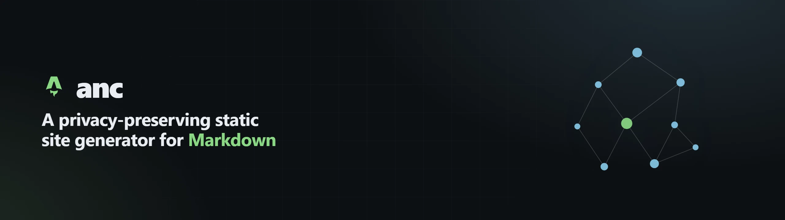
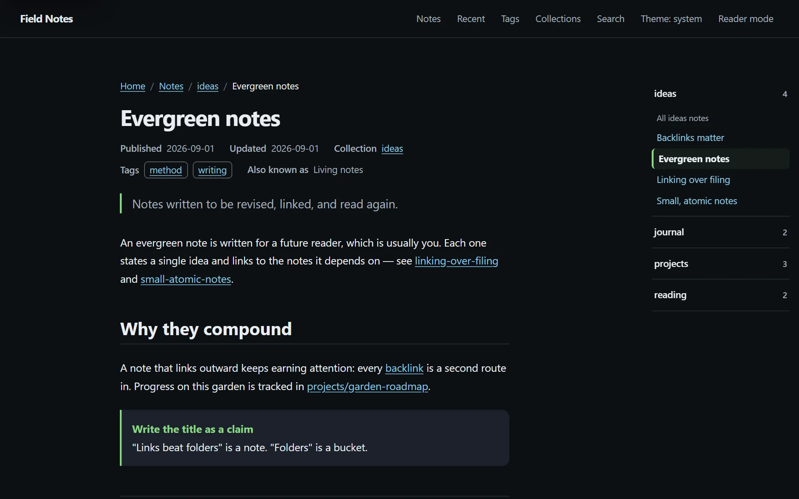
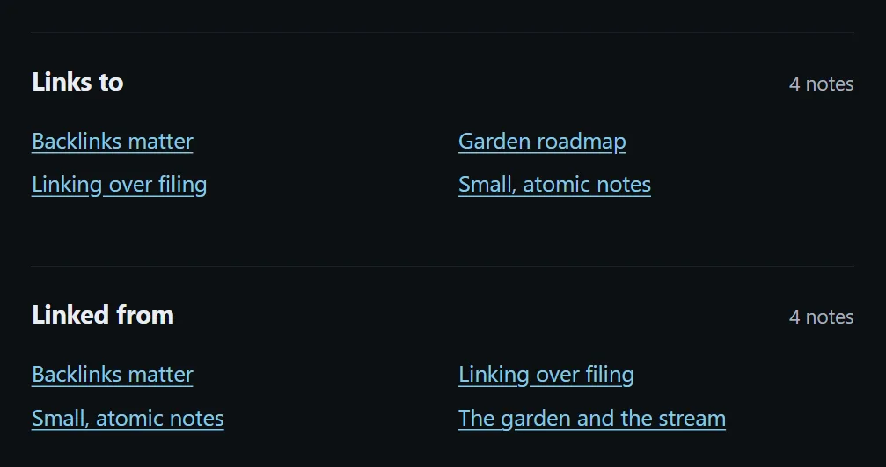
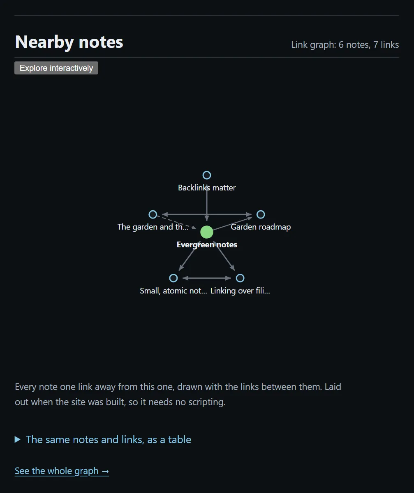
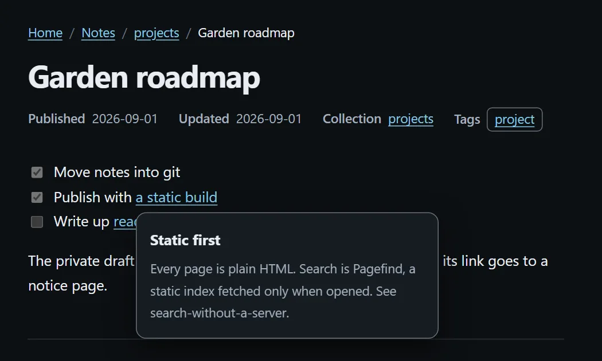
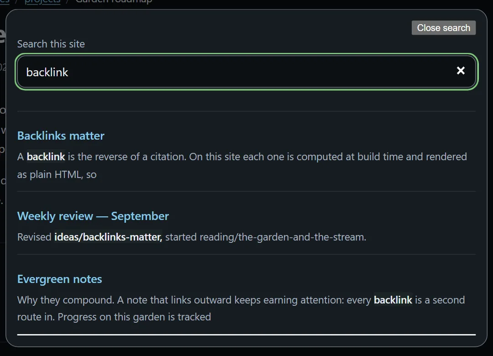

# anc — a privacy-preserving static site generator for Markdown notes and digital gardens

[](#status)
[](https://www.npmjs.com/package/@wxxb789/anc)
[](#working-on-the-tool)
[](https://github.com/wxxb789/anc/actions/workflows/verify.yml)
[](LICENSE)
[](docs/core-design/README.md)

[English](README.md) · [简体中文](README_zh-cn.md)



**anc turns a git repository of Markdown into a self-hosted static knowledge
garden**: articles, backlinks, a link graph, breadcrumbs, tags, collections, a table
of contents, full-text search, feeds, and a sitemap — all rendered ahead of time into
plain static files that any host can serve.

It reads the notes you already have, including Obsidian-style `[[wikilinks]]`, and
needs no database, server, or account. Every note publishes unless you exclude it.
Ordinary reading needs no JavaScript, and nothing is sent to a third party.



*anc* is short for **A**ctive **N**oise **C**ancelling. The command it installs is
`anc`; the package is [`@wxxb789/anc`](https://www.npmjs.com/package/@wxxb789/anc) on
npm.

## Contents

- [Status](#status)
- [Why anc](#why-anc)
- [Features](#features)
- [How it works](#how-it-works)
- [Screenshots](#screenshots)
- [Quick start](#quick-start)
- [How publication is decided](#how-publication-is-decided)
- [Links, tags, and metadata](#links-tags-and-metadata)
- [Architecture](#architecture)
- [Working on the tool](#working-on-the-tool)
- [Adoption and hosting](#adoption-and-hosting)
- [FAQ](#faq)
- [Documentation](#documentation)
- [License](#license)

## Status

**Pre-release.** The tool builds, previews, ships the GitHub Action, and is on the
registry. [`@wxxb789/anc`](https://www.npmjs.com/package/@wxxb789/anc) publishes from a
`vX.Y.Z` tag through the `release` workflow, and each release carries SLSA provenance
generated by npm's trusted publishing. `0.0.1` was published by hand for one reason: a
trusted publisher is configured on a package page that has to exist first. The name is
scoped because the unscoped `anc` already belongs to an unrelated package.
[`docs/adoption.md`](docs/adoption.md) covers configuration, exclusion, links, and
hosting. ANC is not yet 0.1.0-ready or 1.0.0-ready and makes no backward-compatibility
promise.

## Why anc

- **Your notes stay yours.** Markdown in git is the source of truth. There is no
  import step, no proprietary vault format, and no hosted service to subscribe to.
- **Privacy is decided at publication.** `publish: false` and exclusion globs withhold
  a note, a typo in a pattern fails the build instead of leaking drafts, and the build
  log never prints a withheld file's name.
- **A digital garden, not a blog.** Backlinks and the link graph are computed at
  build time from how your notes link; hover previews and graph exploration read the
  same public snapshot lazily.
- **Static and portable.** The output is a `dist/` folder of HTML, CSS, a Pagefind
  index, and one SQLite file. GitHub Pages, Cloudflare Pages, Netlify, or any web
  server can host it at the root of a domain.

## Features

| Surface | What you get |
| --- | --- |
| Markdown | CommonMark plus GFM: tables, task lists, footnotes, callouts, highlighted code |
| Links | `[[wikilinks]]`, relative and root-anchored links, Markdown links, and note embeds |
| Relationships | Backlinks, outgoing links, and a link graph, rendered to static HTML |
| Navigation | Tags, collections, breadcrumbs, table of contents, and recent changes |
| Search | Pagefind full-text search, with a per-document language |
| Rich content | Client-rendered math and Mermaid diagrams, each with a source fallback |
| Discovery | Atom feed, sitemap, `robots.txt`, canonical URLs, and Open Graph metadata |
| Languages | Per-document chrome in English and Simplified Chinese (`zh-CN`) |
| Privacy | Default-publish with explicit withholding; released names stay out of logs |
| Delivery | Static HTML by default; a public SQLite/WASM snapshot for lazy previews |
| Security | A strict Content-Security-Policy in `dist/_headers`; no trackers or analytics |

## How it works


1. **Write** Markdown in the git repository you already keep, in any editor —
   Obsidian, VS Code, or plain `vim`.
2. **Build** with `anc build`. Exclusions are applied first, then every link is
   resolved and every page is rendered ahead of time.
3. **Host** the resulting `dist/` folder anywhere that serves static files.

## Screenshots

Every image below is a real page built by anc from a small synthetic garden;
[`docs/assets/make-screenshots.mjs`](docs/assets/make-screenshots.mjs) regenerates them.

| Backlinks and outgoing links | Local link graph |
| --- | --- |
|  |  |
| **Hover preview** | **Full-text search** |
|  |  |

## Quick start

Install it in the notes repository you want to publish:

```bash
npm install -D @wxxb789/anc       # or: pnpm add -D @wxxb789/anc
npx @wxxb789/anc init             # seed .gitignore and write publish.config.yaml
```

Then name the commands in that repository's `package.json`; the same scripts work
under pnpm and npm:

```json
{
  "scripts": {
    "build": "anc build",
    "preview": "anc preview",
    "review": "anc review",
    "release": "anc build --release"
  }
}
```

```bash
pnpm run build     # or: npm run build
pnpm run preview   # serves dist/ at http://localhost:4321/
pnpm run review    # write .publish-set.json for inspection
pnpm run release   # exact publish set + pinned Gitleaks on PATH
```

Without installing, `npx @wxxb789/anc build --content ~/notes --out ~/notes/dist` runs
the published release, and `npx @wxxb789/anc preview --dist ~/notes/dist` serves the
result. **Do not type bare `npx anc`:** the unscoped `anc` on npm is an unrelated
third-party package, and `npx` would offer to download and run it.

To try an unreleased commit instead, build the tarball from a checkout and install that;
the scripts above apply to it too:

```bash
cd /path/to/anc && pnpm run pack:tarball
cd ~/notes
pnpm add -D /path/to/anc/wxxb789-anc-*.tgz   # or: npm install -D …
```

## How publication is decided

**Everything publishes unless you exclude it.** There is no allowlist and no
`publish: true` to opt in with. Two mechanisms withhold a note, and when they
disagree the one pointing at *not publishing* wins:


```markdown
---
publish: false
---
```

```yaml
# publish.config.yaml
title: Field Notes
origin: https://notes.example.org/
exclude:
  - "drafts/**"
  - "clients/**"
```

A pattern that matches nothing stops the build. That is deliberate: `draft/**` typed
for `drafts/**` would otherwise build green while the drafts went live. A link to a
withheld note keeps the full label and path you wrote, resolves to `/private/`, and is
reported; the withheld note's own body, title, and excerpt reach nothing.

The build prints counts and no filenames. The list of dropped files goes to
`content-report.json` under `<git-dir>/publish-report/` (or your user state directory
outside git), which `git add -A` cannot reach and which is never copied into `dist/`.
A workflow log on a public repository is world-readable, so a withheld file's path is
a disclosure there; that is why the names and the counts are split.

## Links, tags, and metadata

- Five link spellings resolve in one pass, following Obsidian's own order: `[[note]]`,
  `[[./sibling]]`, `[[folder/note]]`, `[text](../other.md)`, and `[[note|shown]]`.
- Tags come from a frontmatter list, and each one gets a `/tags/<key>/` page. The
  first folder under the content root becomes the flat collection.
- Git history supplies `created` and `updated`; frontmatter does not.
- Frontmatter can set `slug`, `language`, `description`, `tags`, and `aliases`.
  Aliases are public, searchable metadata with no route of their own — deliberately
  not alternate link targets.
- Local images referenced by a published note are published under
  `/_assets/<sha256>-<name>`, identified by the **emitted** bytes and deduplicated by content,
  so one picture is one file however many notes embed it. A JPEG photograph becomes lossy
  WebP only when the candidate is smaller; a PNG screenshot, diagram, or alpha graphic
  becomes lossless WebP only when that is smaller. Existing WebP/AVIF and every animation
  are published unchanged, with every frame and delay. A local, self-contained **static SVG**
  is build-only input: it is validated against a fail-closed XML/CSS subset, rasterized from
  its bytes to lossless WebP at twice its logical size, and its source is never served. Every
  external reference, `data:` payload, script, animation, foreign namespace, DTD and CSS
  at-rule is refused; text no installed font covers fails the build rather than publishing
  tofu. No resize, crop, responsive matrix, image CDN, browser script, per-image setting, or
  bundled font exists. A reference resolves relative to the note, then the content root; a
  missing, excluded, escaping, corrupt, over-limit, or unsupported one fails the build rather
  than shipping a broken picture. Remote images are left as written and never fetched. A
  standalone image's explicit Markdown title becomes a visible `<figcaption>` while `alt`
  stays the accessible alternative; dimensions come from the emitted bytes — half the emitted
  raster for a 2× SVG (the logical size unless the output budget clamped it, in which case the
  layout shrinks with the raster) — so layout space is reserved, and the first image loads
  eagerly while later ones defer.
- The encoder and SVG rasterizer are the pinned `sharp` package, installed as an ordinary
  dependency with its prebuilt platform binary: no system CLI, `cwebp`, `librsvg`, `resvg`,
  or `libvips` install step. SVG text uses the build host's fonts, and missing coverage fails
  rather than adding a bundled font. Linux x64 is the platform exercised by this repository's
  gates; Windows and macOS use sharp's prebuilt packages but were not exercised here, and
  cross-platform byte equality is not promised.

## Architecture

Long-term architecture is documented in [`docs/core-design/`](docs/core-design/README.md);
bounded development outcomes and their completion evidence live in
[`docs/goals/`](docs/goals/README.md). Markdown stays canonical, the compiler IR stays
private, static HTML delivers pages, and Pagefind owns full-text search.

- Astro `output: "static"`; the build output is `dist/`.
- Content is produced by `scripts/markdown-to-artifact.ts` and `scripts/resolve-links.ts`,
  then validated against `src/lib/schema.ts` before anything renders.
- The one public relational and preview index is `data/site.<sha256>.sqlite`, holding
  `nodes`, `edges`, `aliases`, `tags`, and `node_tags`. It contains no page body and no
  SQLite FTS; the browser fetches it lazily in a read-only Worker for hover previews,
  tag browsing, and graph exploration.
- Base interactive surfaces are a few KB gzip of vanilla script. Pages containing math
  or diagrams lazy-load the accepted client renderers; both have source fallbacks.
- No D1, R2, Functions, analytics, comments, or build-time data service. A runtime
  application server is not required.

## Working on the tool

```bash
pnpm install
pnpm run verify          # lint, check, build, inventory, secret/residue scans, tests
pnpm run build           # the build chain alone
pnpm run build:fixture   # rebuild against the 32-note corpus
pnpm run build:example   # build example/ into .tmp/example-dist
pnpm run preview:example # serve the example build locally
pnpm run pack:tarball    # compile TypeScript and pack the installable tarball
pnpm run smoke:tarball   # install that tarball in a foreign repo and read it
```

`pnpm run verify` requires the exact Gitleaks version exported by
`scripts/scan-secrets.ts` on `PATH`; an ordinary `pnpm run build` does not.
`packageManager` in `package.json` pins the pnpm version, which `corepack enable`
honours. Dependencies install into a symlinked `node_modules`, so a package not
declared in `package.json` does not resolve — a boundary rather than a preference.

Read [`AGENTS.md`](AGENTS.md) before changing anything. It carries the verification
contract, what runs where, and what is known stale and whose it is. The synthetic
corpus under [`example/`](example/) is the smallest useful feature tour, with public
notes, both exclusion mechanisms, links and backlinks, rich Markdown, math, and Mermaid.

## Adoption and hosting

The GitHub Action at the repository root runs a release build on a supported Linux
runner, installs the checksum-pinned secret scanner, and writes a static `dist/`. Pin it
to `@v0.0.2` for one exact release, `@v0` to follow the latest 0.x, or a full commit SHA
for the strongest pin. Any static host serves that directory, at the root of a domain:
a site under a path such as `https://<user>.github.io/<repo>/` is not supported.
`dist/_headers` carries a Content-Security-Policy and three other security headers in
Cloudflare Pages' format; a host that ignores that file still gets the policy from each
page's `<meta>` tag, except `frame-ancestors`, and serves the other headers only if
configured to.

Publication is an explicit external side effect. Building does not deploy, and nothing
in this repository can. [`docs/adoption.md`](docs/adoption.md) covers both the Action
and a hand-assembled GitHub Pages example, with no secrets required.

## FAQ

**Can anc publish an Obsidian vault?**
Yes: point `--content` at the vault. anc reads Obsidian-style `[[wikilinks]]`,
`[[note|shown text]]`, note embeds, and callouts; keeping the vault in git also gives
each page its created and updated dates. Plugins and non-Markdown attachments are not
processed.

**Do I need a server, a database, or an account?**
No. The output is static files. Search runs from a Pagefind index and relationships
from one SQLite file, both fetched by the reader's browser only when used.

**How do I keep a note private?**
Add `publish: false` to its frontmatter, or match its path with an `exclude:` glob in
`publish.config.yaml`. See [How publication is decided](#how-publication-is-decided).

**Does the site work without JavaScript?**
Reading, navigation, backlinks, and the link graph's table fallback are plain HTML.
Search, hover previews, math, and diagrams need JavaScript.

**Where can I host it?**
Any static host at the root of a domain: GitHub Pages, Cloudflare Pages, Netlify, or
your own web server. See [Adoption and hosting](#adoption-and-hosting).

## Documentation

- [`docs/adoption.md`](docs/adoption.md) — what a stranger with a notes repository does.
- [`docs/core-design/`](docs/core-design/README.md) — authoritative long-term architecture.
- [`docs/goals/`](docs/goals/README.md) — active goals and the completed-goal archive.
- [`docs/gate-reading.md`](docs/gate-reading.md) — the seven ways an instrument lies
  about itself.
- [`AGENTS.md`](AGENTS.md) — contributor workflow and the verification contract.
- [`example/`](example/) — a synthetic corpus demonstrating every public surface.

[Astro documentation](https://docs.astro.build) · [Pagefind documentation](https://pagefind.app/docs/)

## License

Released under the [MIT License](LICENSE).

---

[English](README.md) · [简体中文](README_zh-cn.md)
